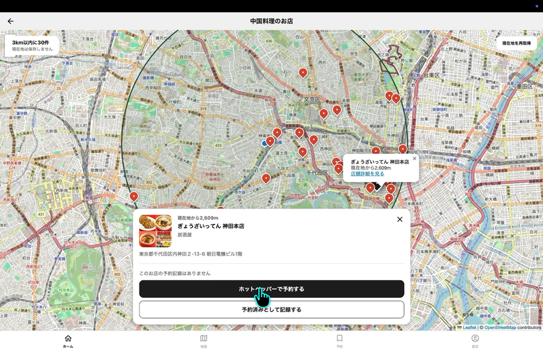

# 食べ図（たべず）

## デモ動画

[](docs/assets/app-demo.mp4)

上の画像をクリックすると、店舗検索や予約操作の画面収録を再生できます。

## 製品概要
### 背景(製品開発のきっかけ、課題等）
海外や日本各地に旅行したくても、円安などでお金がなかったり、忙しくて時間がなかったりして行けない人がいます。そんな人が、手軽に海外旅行の気分を味わえる方法がほしい、というのが出発点です。

**想定ユーザー**：旅行に行きたいけれど、お金や時間の余裕がない人

### 製品説明（具体的な製品の説明）
国を選び、その国の料理を食べられる近くのお店を探して予約し、食べた料理の写真を撮ると、アプリの世界地図（または日本地図）でその国が塗られていくアプリです。

| | 流れ | 画面 |
|---|---|---|
| 1 | 国を選ぶ | ホーム（おすすめの国特集・国カード）、国名から選ぶ（検索つき） |
| 2 | 地図からお店を探す | 現在地から3km以内のお店を地図と一覧で表示（日本は都道府県を選び、その郷土料理を探す） |
| 3 | 予約サイトで予約 | お店の「店舗詳細を見る」から、ホットペッパーグルメの店舗ページを外部ブラウザで開く |
| 4 | アプリに予約を記録 | お店の情報が入った状態で予約を作成し、「予約したお店」に一覧表示 |
| 5 | お店で料理の写真を撮る | 予約カードの「写真を撮る」からカメラで撮影し、メモをつけて記録 |
| 6 | 地図が塗られる | 地図タブの世界地図／日本地図で、記録した国・都道府県が塗られる |

**対応国（12か国）**：日本、韓国、中国、タイ、ベトナム、インド、イタリア、フランス、スペイン、メキシコ、トルコ、アメリカ

### 特長
#### 1. 「どの国の料理を食べるか」から「どこで食べるか」までつながる
国を選ぶと、端末の現在地から3km以内にある、その国の料理のお店をホットペッパーグルメで検索し、地図に表示します。日本を選んだ場合は都道府県を選び、その郷土料理（例：沖縄なら「ソーキそば」など）で検索します。

#### 2. 予約から来店までを1本の流れで記録できる
地図で選んだお店から、店名やジャンルが入った状態で予約を記録できます。予約を記録したお店は、地図でそのお店を選ぶと「予約済み」と予約日時が表示されます。予約カードからは、そのまま写真の記録に進めます。

#### 3. 食べた国が塗られていく「スタンプ地図」
写真を記録すると、世界地図・日本地図（47都道府県）の該当する地域が塗られます。地域をタップすると、その地域で記録したお店の一覧を見られます。訪問記録は端末に保存されます。

### 解決出来ること
- 旅行に行けなくても、国内で「その国の料理」を食べることで、手軽に海外旅行の気分を味わえる
- 食べたい国の料理を出すお店を自分で探す手間が減る
- 食べた国が地図に積み重なるので、「次はどの国を食べに行こう」という楽しみが続く

### 今後の展望
TODO：チームで記入

参考として、コード上で「今後の対応」としているもの（下の「実装状況」を参照）：
- 予約時間の通知（`expo-notifications` を使う想定）
- 予約データの保存（今はアプリを再起動すると消える）

### 注力したこと（こだわり等）
* TODO：チームで記入

## 開発技術
### 活用した技術
#### API・データ
* [ホットペッパーグルメ Webサービス](https://webservice.recruit.co.jp/doc/hotpepper/reference.html)（グルメサーチAPI）：お店の検索。APIキーはバックエンドだけで管理し、アプリには渡さない
* [OpenStreetMap](https://www.openstreetmap.org/)：Web 版の地図タイル
* [pycountry](https://pypi.org/project/pycountry/)：国名・国コード（ISO 3166）
* 自作データ（[backend/app/data/](backend/app/data/)）：12か国の料理と検索キーワード、47都道府県と郷土料理の対応

#### フレームワーク・ライブラリ・モジュール
* **フロントエンド**：React Native 0.86 / Expo SDK 57 / Expo Router / TypeScript
  * 地図：react-native-maps（iOS・Android）、Leaflet・react-leaflet（Web）
  * スタンプ地図：react-native-svg、@svg-maps/world（世界地図）、japan-map-svg（日本地図）
  * 現在地：expo-location　／　写真：expo-image-picker、expo-file-system
  * 端末への保存：@react-native-async-storage/async-storage
* **バックエンド**：Python 3.13 / FastAPI / Uvicorn / httpx / pytest
* **開発環境**：Docker Compose

#### デバイス
* iOS・Android（Expo Go）
* Web ブラウザ（Expo Web）

### 独自技術
#### ハッカソンで開発した独自機能・技術
リポジトリ作成時のテンプレート（Initial commit `7dd6009`）以外は、2026年10月17日〜18日に開発しました。

* **現在地周辺の料理検索 API**（[backend/app/hotpepper.py](backend/app/hotpepper.py)）
  * 国コードと緯度・経度を受け取り、その国の料理をホットペッパーで検索します。
  * 返ってきたお店を実際の距離で絞り込み、3km以内のものを近い順に返します。
  * 日本の場合は、都道府県ごとの郷土料理の複数キーワードで検索し、重複を除きます（[regional_cuisines.py](backend/app/regional_cuisines.py)）。
  * 該当コミット：`7f809e0`、`bf85477`、`dfa2128`
* **スタンプ地図**（[StampMapScreen.tsx](mobile/src/screens/StampMapScreen.tsx)、[StampMap.tsx](mobile/src/components/StampMap.tsx)）
  * 端末に保存した訪問記録から、世界地図・日本地図の該当地域を塗ります。
  * 該当コミット：`5e05175`、`457a78e`
* **お店の地図と予約の記録**（[ShopMapScreen.tsx](mobile/src/screens/ShopMapScreen.tsx)、[RestaurantMap.web.tsx](mobile/RestaurantMap.web.tsx)）
  * 1つの画面で、iOS・Android ではネイティブの地図を、Web では Leaflet を切り替えて使います。
  * 選んだお店の情報を引き継いで、予約を記録できます。
* **Figma のデザインを共通部品にした UI**（[mobile/src/components/](mobile/src/components/)）
  * ヘッダー・タブバー・ボタン・トグル・各種カードを共通部品にしています。
  * 色や文字の大きさは [theme.ts](mobile/src/constants/theme.ts) にまとめています。
  * 該当コミット：`f8a52f4`、`62cef3e`、`03e32fb`

## 実装状況（仮実装・未実装の部分）
| 機能 | 状況 |
|---|---|
| 近くのお店の検索・地図表示 | 実装済み（ホットペッパーAPI＋現在地）。APIキーの設定が必要 |
| 予約 | アプリ内では予約しない。ホットペッパーの店舗ページを外部で開き、予約した内容をアプリに手で記録する |
| 写真の撮影 | 実装済み（端末のカメラ）。Web 版ではブラウザの機能で撮影・画像選択する |
| スタンプ地図 | 実装済み。訪問記録は端末に保存される |
| 予約時間の通知 | **未実装**。予約作成画面と設定画面のトグルはオン・オフを覚えるだけで、通知は届かない |
| 予約一覧の保存 | **未実装**。アプリを再起動すると、初期のダミー予約に戻る |
| ホームのおすすめ特集・国カード・「今まで訪れたお店」の初期表示 | **ダミーデータ**（写真は Unsplash） |
| 設定「記録をリセット」 | ホームの「今まで訪れたお店」だけが消え、地図に使う端末保存の記録は消えない |
| 日本の都道府県検索 | 選んだ都道府県の中のお店ではなく、現在地の近くにある「その郷土料理のお店」を探す |

## セットアップと起動
詳しい手順（Docker のインストール、実機・シミュレーターでの起動など）は [docs/DEVELOPMENT.md](docs/DEVELOPMENT.md) を参照してください。

**必要なもの**：Docker、Node.js 24、（実機の場合）Expo SDK 57 対応の Expo Go

```bash
# 1. バックエンド（http://localhost:8001/docs で API を確認できます）
cp .env.example .env          # HOTPEPPER_API_KEY に自分のAPIキーを設定
docker compose up --build -d backend

# 2. アプリ
cd mobile
npm ci
cp .env.example .env
npm run web                   # ブラウザ（http://localhost:8000）
npm start                     # 実機（QRコードを Expo Go で読み取る）
```

**環境変数**（値は各自で設定し、リポジトリには含めません）

| 変数名 | 場所 | 内容 |
|---|---|---|
| `HOTPEPPER_API_KEY` | `.env` | ホットペッパーの API キー（[発行ページ](https://webservice.recruit.co.jp/register)） |
| `BACKEND_PORT` / `BACKEND_HOST` / `CORS_ORIGINS` | `.env` | バックエンドのポート・公開範囲・許可するオリジン |
| `EXPO_PUBLIC_API_URL` | `mobile/.env` | 実機・シミュレーターから見たバックエンドの URL |
| `EXPO_PUBLIC_WEB_API_URL` | `mobile/.env` | Web 版から見たバックエンドの URL |

## チームと役割
| 名前 | 役割 |
|---|---|
| 砂山 光 | バックエンド・API |
| 村山 朔 | デザイン・フロントエンド |

## クレジット・出典
* Powered by [ホットペッパーグルメ Webサービス](http://webservice.recruit.co.jp/)
* 画像提供：ホットペッパー グルメ（お店の写真）
* 地図データ：© [OpenStreetMap](https://www.openstreetmap.org/copyright) contributors
* 世界地図：[@svg-maps/world](https://github.com/VictorCazanave/svg-maps)（[MapSVG](https://mapsvg.com/maps/world) をもとにした地図、[CC BY 4.0](https://creativecommons.org/licenses/by/4.0/)）
* 日本地図：[japan-map-svg](https://github.com/lalamalink/japan-map-svg)（CC0 1.0）
* 料理の写真（ダミーデータ）：[Unsplash](https://unsplash.com/)（[Unsplash License](https://unsplash.com/license)）

<details>
<summary>Unsplash の写真の撮影者</summary>

| 料理 | 撮影者 |
|---|---|
| 寿司 | [Marta Filipczyk](https://unsplash.com/photos/sushi-on-plate-7BQC4h7wd9Y) |
| ビビンバ | [Dmitry Pavlovsky](https://unsplash.com/photos/SbHulgzS_eo) |
| 小籠包 | [Amos K](https://unsplash.com/photos/steamed-dumplings-served-in-a-bamboo-steamer-basket-idUSfFfqLmw) |
| パッタイ | [John Aledia](https://unsplash.com/photos/a-plate-of-food-on-a-wooden-table-_wBJ0cvKhIE)、[Raphael Bernhart](https://unsplash.com/photos/sE4UdOjoYr4) |
| フォー | [Kirill Tonkikh](https://unsplash.com/photos/a-bowl-of-noodle-soup-with-chopsticks-on-the-side-NFQi_2HUNRI) |
| チキンカレー | [Imad 786](https://unsplash.com/photos/delicious-indian-chicken-curry-and-rice-ready-to-eat-gwUA_pHaOYY) |
| ピザ | [Luigi Boccardo](https://unsplash.com/photos/a-pizza-with-cheese-and-basil-wgq8NVyXsYY)、[Roberto Vincenzo Minasi](https://unsplash.com/photos/a-pizza-with-mozzarella-and-basil-on-a-plate-L4W1uX1xwlQ)、[Thomas Schweighofer](https://unsplash.com/photos/person-about-to-slice-pizza-on-white-plate-p7Q36vPBFs8) |
| クロワッサン | [Juliana Barquero](https://unsplash.com/photos/a-croissant-sitting-on-a-plate-on-a-table-UQQN7WJQg6M) |
| パエリア | [Armando Brenlha](https://unsplash.com/photos/cooked-food-on-black-plate-EufUgeuCa7Y) |
| タコス | [Jeswin Thomas](https://unsplash.com/photos/beef-tacos-with-onion-and-cilantro-z_PfaGzeN9E)、[Frankie Lopez](https://unsplash.com/photos/a-wooden-plate-topped-with-three-tacos-and-a-lime-_j4S4V2C8ew) |
| ラフマジュン | [Markus Winkler](https://unsplash.com/photos/delicious-looking-turkish-lahmacun-ready-to-be-served-CAmLnpQXcIY) |
| ハンバーガー | [Taylor Harding](https://unsplash.com/photos/burger-with-fries-WIkkaFBYQ08) |

</details>
